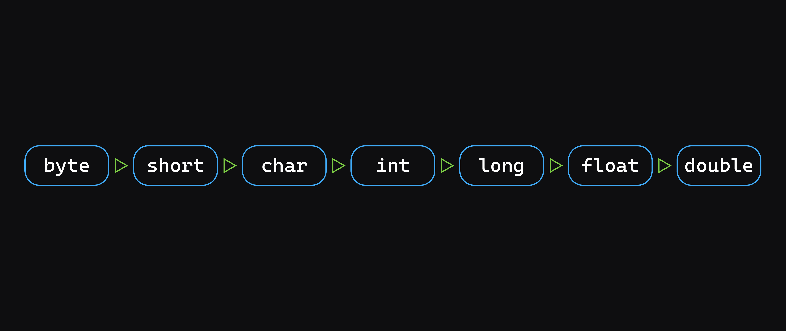
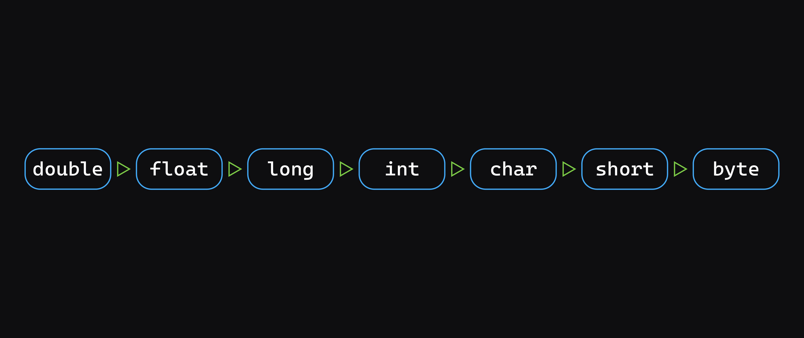

<h1>
  <span class="headline">Java Data Types and Variables</span>
  <span class="subhead">Converting Between Data Types</span>
</h1>

**Learning objective:** By the end of this lesson, students will be able to distinguish between implicit and explicit casting in Java and use each to handle type conversions safely.

<div class="activity guided-walkthrough">
  <h2 class="title">Implicit and explicit casting</h2>
  <span class="minutes">10 min</span>
</div>

Sometimes, it's necessary to convert between data types. For example, user input is **always** a string. So when a user provides information such as their age or income you'll need to convert it to a numeric data type before you're able to do anything useful with it.

### Implicit casting

Remember how we talked about the size of primitive data types in memory? A `float` is smaller than a `double`, and a `double` is smaller than a `long`.

When converting from smaller types to larger types, for example, an `int` (4 bytes) to a `double` (8 bytes), conversion is done automatically as long as the types are compatible. This is called **implicit casting** or **widening**:

```java
int a = 100;
double b = a;
System.out.println(b);
```

This diagram demonstrates what types can be implicitly cast. A data type can be implicitly cast to any data type to its right. For example, an `int` can be implicitly cast to a `long`, `float`, or `double`, while a `float` can only be implicitly cast to a `double`:



### Explicit casting

If you're converting from a bigger data type to a smaller data type — for example, `double` (8 bytes) to `int` (4 bytes) — the change in data type must be clearly marked. This is called **explicit casting** or **narrowing**:

```java
double a = 100.7;
int b = (int) a;
System.out.println(b);
```

Explicit casting can be problematic. If you attempt to narrow data that is too large to fit into the smaller amount of memory then the excess will be lost.

This diagram demonstrates what types must be explicitly cast. A data type must be explicitly cast to any data type to its right. For example, an `int` must be explicitly cast to a `char`, `short`, or `byte`, while a `short` only needs to be explicitly cast to a `byte`:



## Parsing strings

So far all of our implicit and explicit casting has just worked with integers, but sometimes, like in our example of converting user input above, we need a way to turn a string into a number type.

This can be accomplished by utilizing a method on the class of the type you'd like to transform your data into. Let's see an example converting a string to an integer.

In addition to the `int` data type, there is also an `Integer` class. The `Integer` class is a wrapper around an `int` data type that provides helpful methods for interacting and working with integers.

For example, to convert a string to an integer, you can use the `parseInt()` method:

```java
String strValue = "42";
int intValue = Integer.parseInt(strValue);
System.out.println(intValue);
// Prints: 42
```

Similar methods exist for the other types we've discussed - `Double`, `Float`, `Long`, `Character` (for the `char` type), `Short`, and `Byte`.
