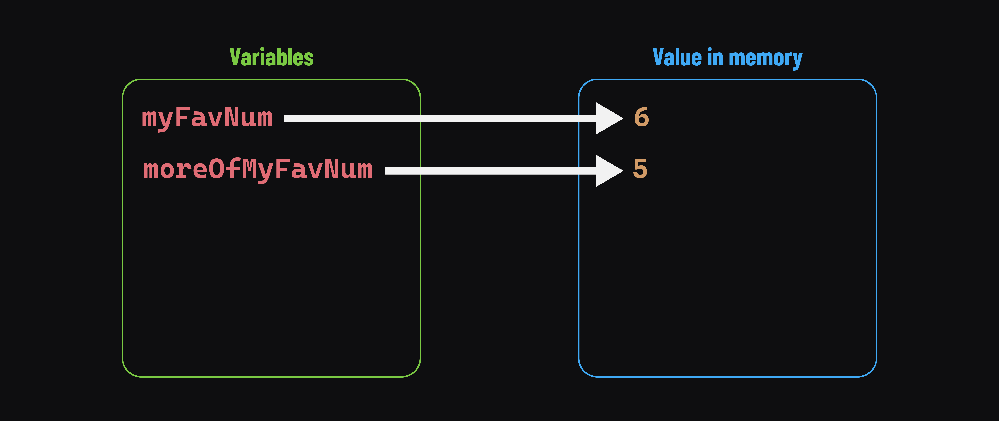
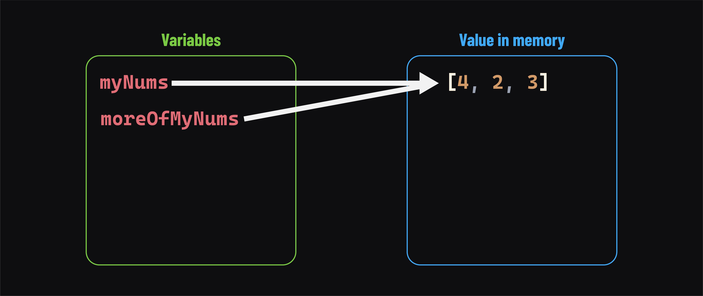

<h1>
  <span class="headline">Java Data Types and Variables</span>
  <span class="subhead">Primitive vs. Object Types</span>
</h1>

**Learning objective:** By the end of this lesson, students will be able to identify when to use primitive types versus object types to optimize memory usage and program performance.

<div class="timed-section">
  <h2>What is an object type?</h2>
  <span class="minutes">10 min</span>
</div>

Have you noticed that all the data types we've discussed so far begin with a lowercase letter? You might already be familiar with creating string variables using `String` - which starts with an uppercase letter. Why is that?

This is because `String` is a class. When you use it to create a new string, that string is actually an object created as an instance of the `String` class, hence the name object type. The new object will have properties and methods that you can use to carry out operations on the string data itself. We'll see this in action soon.

Primitive types always start with a lowercase letter (`int`, `double`, and `boolean`), while object types start with an uppercase letter - a reflection of the class used to create them (`String`, for example).

### Java is pass by value

The concepts of *pass by value* and *pass by reference* help distinguish programming languages from one another. These concepts broadly describe how data passes between variables, functions, or methods in a language.

Java is **pass by value**. However, the value passed can change depending on whether we work with a primitive or object type. Fortunately, this means that Java functions similarly to most modern languages.

#### Primitive types

**Primitive data types** are **pass a value**. Assigning primitive data to a variable or passing it to a method is like writing that data on a physical Post-it note and handing it off. Take this code for example:

```java
int myFavNum = 5;
int moreOfMyFavNum = myFavNum;

myFavNum++;

System.out.println(myFavNum);
// Prints: 6
System.out.println(moreOfMyFavNum);
// Prints: 5
```

On this line: `int myFavNum = 5;`, `myFavNum` was given a Post-it note with the integer `5` on it.

Then, on this line: `int moreOfMyFavNum = myFavNum;`, `moreOfMyFavNum` received its own copy of `myFavNum`'s Post-it note, again with the integer `5` on it. `myFavNum` kept its Post-it note.

From that point on, the values in `myFavNum` and `moreOfMyFavNum` were able to diverge. `myFavNum` eventually becomes `6`, and moreOfMyFavNum remains the same (`5`).



#### Object types

**Object data types** are also **pass by value**, but the value they pass is **a reference**. In other words, variables of any object data type only store a reference to a piece of data, not the data itself. When we assign that value to another variable, what gets passed is the reference - not the actual value.

> 💡 Object data types in Java are often called reference data types because of this. You can use either term safely.

This means that object data types hold data similar to that of a house address. The address is where the house can be found, but it is not literally the house itself. Assigning object data to a variable or passing it to a method will give that variable the same reference - not the house itself.

The below code demonstrates this with the `Array` type. Don't worry too much about the exact code, but notice how we're following the same general steps as above yet getting a different result.

```java
int[] myNums = {1, 2, 3};
int[] moreOfMyNums = myNums;

myNums[0] = 4;

System.out.println(Arrays.toString(myNums));
// Prints: [4, 2, 3]
System.out.println(Arrays.toString(moreOfMyNums));
// Prints: [4, 2, 3]
```

Sticking with our home address analogy, on this line: `int[] myNums = {1, 2, 3};`, `myNums` was given the home address of the `[1, 2, 3]` array - not the array itself.

Then, on this line: `int[] moreOfMyNums = myNums;`, `moreOfMyNums` received its own copy of the home address held by `myNums`. `myNums` still refers to the same address.

From then on, the value in `myFavNum` and `moreOfMyFavNum` were the same - the home address of the `[1, 2, 3]` array.

When we modify the array using either variable, the change is reflected across both because they point to the same thing.


