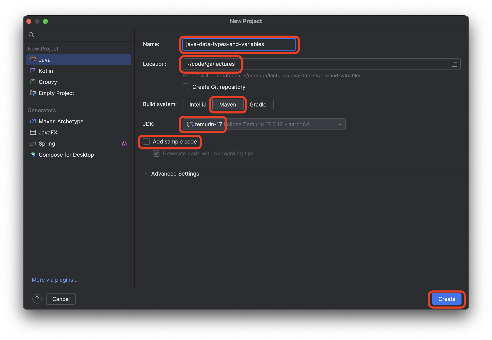
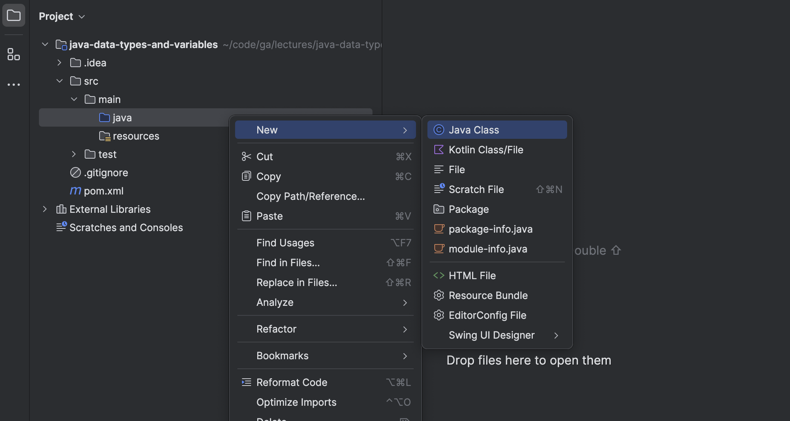
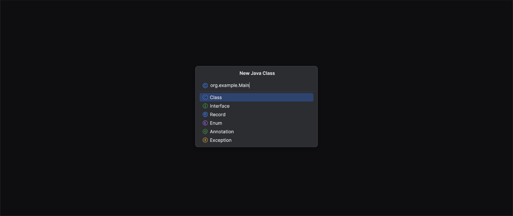
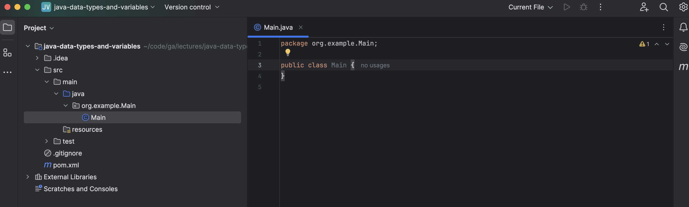
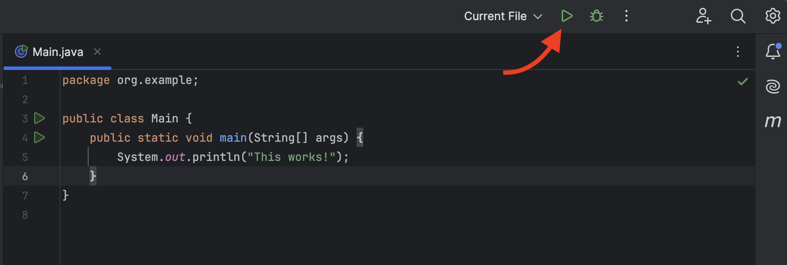

<h1>
  <span class="headline">Java Data Types and Variables</span>
  <span class="subhead">Setup</span>
</h1>

<div class="timed-section">
  <h2>Setup</h2>
  <span class="minutes">10 min</span>
</div>

Launch the IntelliJ IDEA application.

Select the **New Project** option.

Name the project `java-data-types-and-variables`.

Create the project in the <code class="filepath">~/code/ga/lectures</code> directory.

> ⚠️ Windows users, the <code class="filepath">lectures</code> directory is likely at this location on your device: <code class="filepath">C:\Users\username\code\ga\lectures</code> (replacing `username` with your username). Create the project in that directory instead.

From now on we will use a more common project structure - choose the **Maven** build system option.

Ensure the JDK used is **temurin-17**. This should be the default setting when starting a new project. If it's not, alert your instructor.

Ensure that the **Add sample code** option is not checked.

After confirming that the **New project** window looks similar to the screenshot below, select the **Create** button.



With this, we have a new project! Note the new `pom.xml` file in the root directory of our project - this is a configuration file used to build our project. You won't need to touch it for now.

Also, check out the contents of the <code class="filepath">src</code> directory. If you investigate it, you'll find this directory structure has been created for you:

```plaintext
src
├───main
│   ├───java
│   └───resources
|
└───test
    └───java
```

These are the beginnings of the [Maven standard directory layout](https://maven.apache.org/guides/introduction/introduction-to-the-standard-directory-layout.html). As you explore Java, you'll eventually start using these directories, but for now, our work will be contained in the <code class="filepath">src/main/java</code> directory.

This is where we'll create the file for this lecture's work. To do this, right-click on the <code class="filepath">src/main/java</code> directory and select **New** > **Java Class**, as shown in the screenshot below:



Name your new class `org.example.Main` as shown below. This naming follows a standard convention constructed to prevent clashes between different projects. It starts with the reversed internet domain name of the company where the package is created. We don't have a shared domain name, so we use `example.org`, a common placeholder. Finally, we get to the name of our class, `Main`.



When your **New Java Class** prompt looks like the above, select the **Class** option from the list, and you should be taken to the new <code class="filepath">Main.java</code> file as shown in this screenshot:



This may feel like a lot of file structure just for a single file, especially if you have previous experience with languages that prefer a flatter directory structure, but it's a pattern you'll get more comfortable with as you write more Java code.

You don't need to fully understand this directory structure to start working with it, and you can let the understanding come with time. For now, just know that your code can be found in the <code class="filepath">src/main/java/org/example/Main.java</code> file.

Add the required `main()` method inside of the `Main` class, including a print statement to confirm our setup worked:

```java
    public static void main(String[] args) {
        System.out.println("This works!");
    }
```

Run this file now to test that our setup worked. Use the green play button in the top bar shown in the screenshot below, or use <kbd>Ctrl</kbd> + <kbd>R</kbd>.



A **Run** panel will appear at the bottom of the window, and you should see a message: `This works!`

We can get to work now that our project is set up, but first, let's briefly touch on Maven.

### So what is Maven?

In their own words:

>Maven's primary goal is to allow a developer to comprehend the complete state of a development effort in the shortest period of time. In order to attain this goal, Maven deals with several areas of concern:
>
> - Making the build process easy
> - Providing a uniform build system
> - Providing quality project information
> - Encouraging better development practices

In short, the build process can become incredibly complex in large projects - Maven aims to keep those complexities to a minimum and encourage better practices along the way. It favors convention over configuration. Part of that convention is its opinionated directory structure, which we're adopting in our work. Feel free to check out [their site](https://maven.apache.org/what-is-maven.html) if you want to learn more.
